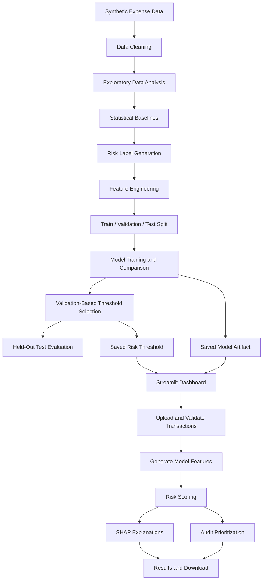

# Financial Expense Anomaly Detection for Corporate Auditing

An end-to-end machine learning project that identifies unusual financial expense transactions, estimates transaction risk, explains model predictions, and helps auditors prioritize expenses for manual investigation through an interactive Streamlit dashboard.

---

## Table of Contents

1. [Project Overview](#1-project-overview)
2. [Problem Statement](#2-problem-statement)
3. [Objectives](#3-objectives)
4. [Key Features](#4-key-features)
5. [System Architecture](#5-system-architecture)
6. [End-to-End Workflow](#6-end-to-end-workflow)
7. [Technologies Used](#7-technologies-used)
8. [Project Structure](#8-project-structure)
9. [Dataset Description](#9-dataset-description)
10. [Data Processing and Feature Engineering](#10-data-processing-and-feature-engineering)
11. [Machine Learning Methodology](#11-machine-learning-methodology)
12. [Model Evaluation](#12-model-evaluation)
13. [Explainable AI Using SHAP](#13-explainable-ai-using-shap)
14. [Audit Prioritization](#14-audit-prioritization)
15. [Streamlit Application](#15-streamlit-application)
16. [Installation and Local Setup](#16-installation-and-local-setup)
17. [Running the Project](#17-running-the-project)
18. [Deployment on Streamlit Community Cloud](#18-deployment-on-streamlit-community-cloud)
19. [Output Files and Reports](#19-output-files-and-reports)
20. [Testing and Validation](#20-testing-and-validation)
21. [Security and Data Privacy](#21-security-and-data-privacy)
22. [Limitations](#22-limitations)
23. [Future Enhancements](#23-future-enhancements)
24. [Conclusion](#24-conclusion)

---

## 1. Project Overview

Financial Expense Anomaly Detection for Corporate Auditing is a machine learning-based decision-support system designed to identify potentially unusual expense transactions in corporate financial records.

Organizations process numerous expenses related to travel, accommodation, equipment, office supplies, meals, and other business activities. Manually reviewing every transaction can be time-consuming and may make unusual transactions difficult to identify efficiently.

This project combines statistical analysis, data preprocessing, feature engineering, supervised machine learning, explainable AI, and audit prioritization to help focus attention on transactions that may require additional investigation.

The application provides an interactive web dashboard built with Streamlit. Users can upload transaction data, obtain risk predictions, inspect flagged transactions, review audit priority levels, and download analysis results.

**Project type:** Machine Learning, Data Analytics, Explainable AI, and Financial Auditing

**Application:** Streamlit web dashboard

**Dataset:** Synthetic financial expense transaction data

**Primary model:** Random Forest classifier

**Explainability:** SHAP

**Deployment platform:** Streamlit Community Cloud

## 2. Problem Statement

Corporate auditing requires the examination of financial transactions to identify unusual amounts, potential duplicate claims, policy violations, and other transactions that may need further investigation.

Traditional manual auditing can require substantial effort when transaction volumes are large. Simple fixed thresholds may also fail to capture differences between expense categories, departments, and employee spending patterns.

The objective of this project is to develop a machine learning-based system that analyzes expense transaction attributes, estimates the likelihood that a transaction belongs to a predefined high-risk category, and prioritizes potentially unusual transactions for auditor review.

The system is intended to support auditors rather than replace professional judgment or independently establish fraud.

## 3. Objectives

The main objectives are:

- Generate and analyze a structured expense transaction dataset.
- Clean transaction data and validate its quality.
- Explore spending patterns across expense categories and departments.
- Calculate statistical baselines for identifying unusual expenses.
- Generate risk labels for supervised model development.
- Engineer transaction-level, temporal, and employee-level features.
- Train and compare machine learning classification models.
- Select a decision threshold using validation performance.
- Evaluate the selected model on a separate held-out test set.
- Explain model predictions using SHAP.
- Generate an audit priority register.
- Develop an interactive Streamlit dashboard.
- Deploy the application through Streamlit Community Cloud.

## 4. Key Features

### 4.1 Transaction data analysis

Analyzes expense amounts, expense categories, payment methods, departments, and transaction timing.

### 4.2 Data cleaning and validation

Checks transaction records for missing values, invalid amounts, duplicate identifiers, and data consistency.

### 4.3 Statistical anomaly detection

Uses category-level statistical baselines and robust statistics to identify expenses that differ from typical spending patterns.

### 4.4 Machine learning risk prediction

Uses a trained Random Forest classifier to produce risk scores for transactions.

### 4.5 Decision threshold selection

Uses validation data to select a threshold based on a target precision requirement and the recall achieved.

### 4.6 Explainable AI

Uses SHAP to investigate how input features contribute to model predictions.

### 4.7 Audit prioritization

Organizes transactions into priority levels to help auditors decide which records to review first.

### 4.8 Interactive dashboard

Allows users to upload transaction data, view analysis results, inspect risk scores, and download results.

### 4.9 Cloud deployment

Makes the dashboard accessible through a deployed Streamlit Community Cloud application.

---

## 5. System Architecture

The system follows a sequential data processing and machine learning architecture.



### Architecture components

| Component | Responsibility |
|---|---|
| Data generation | Creates synthetic expense records |
| Data preprocessing | Cleans and validates the records |
| Statistical analysis | Calculates baselines and anomaly indicators |
| Label generation | Creates the supervised learning target |
| Feature engineering | Constructs model input variables |
| Model training | Trains and compares classifiers |
| Model evaluation | Measures predictive performance |
| Explainability | Analyzes feature contributions |
| Audit prioritization | Assigns review priority levels |
| Streamlit frontend | Provides the interactive user interface |
| Model artifacts | Store the trained model and selected threshold |
| Cloud hosting | Serves the application online |

---

## 6. End-to-End Workflow

The project is organized into the following stages.

### Stage 1: Project definition

The project objective, intended users, target problem, and expected outputs are defined in `project_objective.md`.

### Stage 2: Dataset generation

`generate_dataset.py` creates a synthetic expense dataset containing transaction identifiers, employee identifiers, expense categories, amounts, dates, payment methods, and risk-related attributes.

The generated dataset contains 5,000 records and 11 initial columns.

### Stage 3: Exploratory data analysis

`understand_patterns.py` analyzes the generated data to understand:

- Total and average transaction amounts.
- Median and percentile spending levels.
- Spending patterns by expense category.
- Spending patterns by department.
- Distribution of high-risk records.
- Missing values and duplicate transaction identifiers.

### Stage 4: Data cleaning

`clean_data.py` performs the initial data cleaning and saves the cleaned dataset.

### Stage 5: Statistical baseline analysis

`statistical_baseline.py` calculates statistical indicators, including category-level medians, median absolute deviation (MAD), robust z-scores, and percentile-based anomaly indicators.

The results are saved for subsequent analysis.

### Stage 6: Risk label generation

`label_risk.py` generates the target variable `audit_label` using predefined rules applied to the synthetic data.

The labels provide a target for supervised machine learning. They are not independently verified audit findings.

### Stage 7: Feature engineering

`engineer_features.py` constructs additional variables from transaction dates, expense amounts, categories, and employee-level activity.

Examples include calendar features, category statistics, employee transaction counts, and spending ratios.

### Stage 8: Dataset splitting

`split_data.py` divides the labeled data into training, validation, and test datasets.

The saved split sizes are:

| Dataset | Records | Proportion |
|---|---:|---:|
| Training | 3,500 | 70% |
| Validation | 750 | 15% |
| Test | 750 | 15% |
| **Total** | **5,000** | **100%** |

The split is stratified by the target label. The test set is reserved for final evaluation rather than routine model selection.

### Stage 9: Model training

`train_model.py` trains and compares Logistic Regression and Random Forest models using preprocessing pipelines for numerical and categorical variables.

The selected model is saved as `models/expense_risk_model.joblib`.

### Stage 10: Threshold selection

`evaluate_precision.py` compares different probability thresholds on the validation dataset.

The selected threshold is stored in `reports/risk_threshold.json`.

### Stage 11: Explainability

`explain_anomalies.py` uses SHAP to investigate feature contributions to model predictions and generates explanation reports and visualizations.

### Stage 12: Audit prioritization

`prioritize_audits.py` combines the model output with the implemented transaction-prioritization logic to generate an audit priority register.

### Stage 13: Final model verification

`verify_model.py` evaluates the saved model on the held-out test set and writes the results to `reports/final_test_evaluation.json`.

### Stage 14: Interactive dashboard

`app.py` provides the Streamlit interface for uploading transactions, calculating risk scores, viewing flagged records, and downloading results.

### Stage 15: Input and application testing

`test_app_inputs.py` checks transaction input validation. Additional manual testing verifies dashboard functionality.

### Stage 16: Deployment

The application is committed to GitHub and deployed on Streamlit Community Cloud.

---

## 7. Technologies Used

| Technology | Purpose |
|---|---|
| Python | Main programming language |
| Pandas | Data processing and analysis |
| NumPy | Numerical operations |
| Scikit-learn | Preprocessing, classification, and evaluation |
| Random Forest | Primary classification model |
| Logistic Regression | Comparison model |
| SHAP | Model explainability |
| Matplotlib | Visualization |
| Joblib | Model serialization and loading |
| Streamlit | Interactive web application |
| Git | Version control |
| GitHub | Source code hosting |
| Streamlit Community Cloud | Application hosting |

---

## 8. Project Structure

The principal project files and their responsibilities are listed below.

```text
financial-expense-anomaly-detection/
│
├── app.py
├── requirements.txt
├── README.md
├── project_objective.md
├── .gitignore
│
├── generate_dataset.py
├── understand_patterns.py
├── clean_data.py
├── statistical_baseline.py
├── label_risk.py
├── engineer_features.py
├── split_data.py
├── train_model.py
├── evaluate_precision.py
├── explain_anomalies.py
├── prioritize_audits.py
├── verify_model.py
├── test_app_inputs.py
│
├── data/
│   ├── expense_transactions.csv
│   ├── cleaned_expense_transactions.csv
│   ├── expense_baseline_results.csv
│   ├── labeled_expense_transactions.csv
│   ├── engineered_expense_features.csv
│   └── splits/
│       ├── train.csv
│       ├── validation.csv
│       └── test.csv
│
├── models/
│   └── expense_risk_model.joblib
│
└── reports/
    ├── model_comparison.csv
    ├── best_model_info.json
    ├── risk_threshold.json
    ├── final_test_evaluation.json
    ├── audit_priority_register.csv
    ├── audit_priority_summary.json
    └── shap/
        └── SHAP reports and visualizations
```

The precise set of generated report files may vary depending on which scripts have been executed and how the project has been updated.

---

## 9. Dataset Description

### 9.1 Dataset source

The initial dataset is synthetically generated by `generate_dataset.py`. It is intended for demonstrating the complete machine learning workflow without requiring confidential corporate financial records.

The initial dataset contains 5,000 transactions.

### 9.2 Initial transaction columns

| Column | Description |
|---|---|
| `transaction_id` | Unique transaction identifier |
| `employee_id` | Synthetic employee identifier |
| `department` | Department associated with the expense |
| `expense_category` | Type of expense |
| `amount` | Transaction amount |
| `transaction_date` | Date of the transaction |
| `payment_method` | Method used for payment |
| `is_weekend` | Indicates whether the transaction occurred on a weekend |
| `is_duplicate` | Synthetic duplicate-related indicator |
| `policy_violation` | Synthetic policy-violation indicator |
| `high_risk` | Synthetic high-risk indicator |

Additional columns are introduced during statistical analysis, labeling, and feature engineering.

### 9.3 Target variable

The supervised learning target is `audit_label`.

- `1`: transaction labeled high-risk by the synthetic labeling rules.
- `0`: transaction not labeled high-risk by those rules.

These labels are generated programmatically and should not be interpreted as confirmed fraud or misconduct.

### 9.4 Dataset characteristics

The exploratory analysis recorded the following initial statistics:

| Statistic | Recorded value |
|---|---:|
| Initial transaction records | 5,000 |
| Initial columns | 11 |
| Total transaction amount | ₹31,272,222.84 |
| Mean transaction amount | ₹6,254.44 |
| Median transaction amount | ₹3,852.80 |
| 95th percentile | ₹16,973.49 |
| 99th percentile | ₹43,897.16 |
| Maximum transaction amount | ₹153,422.45 |
| Initial high-risk indicator count | 257 |

These descriptive statistics refer to the initial generated dataset and its `high_risk` indicator. They should not be confused with the later `audit_label` distribution or model predictions.

---

## 10. Data Processing and Feature Engineering

### 10.1 Data cleaning

The cleaning stage prepares records for analysis and modeling by checking data quality and consistency.

The cleaned output is saved to:

`data/cleaned_expense_transactions.csv`

### 10.2 Statistical features

Statistical analysis uses category-level spending distributions to identify unusually large amounts.

The median provides a robust estimate of typical spending, while median absolute deviation measures the dispersion of amounts around the median.

A robust z-score can be expressed as:

\[
z_{\mathrm{robust}} =
\frac{0.6745(x-\mathrm{median})}{\mathrm{MAD}}
\]

This measure can help identify values that differ substantially from the typical amount, provided the dispersion is nonzero.

Percentile-based indicators compare transaction amounts with the observed distribution for an expense category.

### 10.3 Engineered features

`engineer_features.py` creates additional variables, including:

| Feature | Purpose |
|---|---|
| `transaction_month` | Month of the transaction |
| `transaction_day_of_week` | Day of the week |
| `transaction_day` | Day of the month |
| `transaction_day_of_year` | Day number within the year |
| `category_median` | Typical category spending level |
| `category_percentile` | Relative amount position within a category |
| `amount_to_median_ratio` | Amount relative to the category median |
| `robust_z_score` | Robust statistical deviation |
| `employee_transaction_count` | Transaction count associated with an employee |
| `employee_avg_amount` | Average spending associated with an employee |
| `amount_to_employee_avg_ratio` | Amount relative to the employee average |

Some features are excluded from the model to reduce direct leakage from the synthetic labeling process.

The current model also uses `above_category_p95`, a category-based percentile indicator, and the model feature list includes the amount, category, payment method, department, weekend indicator, date-derived variables, and employee transaction count.

**Important implementation consideration:** Features derived from group statistics must be calculated consistently between training and inference. For a stricter evaluation, any learned category or employee statistics should be fitted using training data only and reused for validation, testing, and new uploaded transactions.

---

## 11. Machine Learning Methodology

### 11.1 Classification models

The training pipeline compares two supervised classification approaches.

**Logistic Regression**

A linear classification model used as a baseline. It estimates the relationship between input variables and the probability of the positive class.

**Random Forest**

An ensemble model that combines predictions from multiple decision trees. It can model nonlinear relationships and interactions between transaction attributes.

The model-selection process uses validation PR-AUC, which is useful when identifying the positive class is important and class distributions may be imbalanced.

### 11.2 Preprocessing pipeline

The current training pipeline uses:

- Numerical missing-value imputation.
- Numerical feature scaling.
- Categorical missing-value imputation.
- One-hot encoding of categorical variables.
- A classification model applied after preprocessing.

Using a preprocessing pipeline helps ensure that training and prediction use compatible transformations.

### 11.3 Model artifact

The selected trained model is saved to:

`models/expense_risk_model.joblib`

Model metadata is saved to:

`reports/best_model_info.json`

The model metadata records the selected model, target variable, input features, and excluded leakage-related columns.

---

## 12. Model Evaluation

### 12.1 Evaluation metrics

The project uses several metrics to evaluate the classification model.

**Accuracy**

The proportion of all transactions classified correctly.

**Precision**

The proportion of transactions predicted as high-risk that are positive under the evaluation labels.

**Recall**

The proportion of positive high-risk labels successfully identified by the model.

**F1-score**

The harmonic mean of precision and recall.

**Precision-Recall AUC (PR-AUC)**

Summarizes precision-recall performance across classification thresholds.

For an auditing workflow, precision helps assess false alarms, while recall helps assess how many labeled high-risk transactions are identified.

### 12.2 Recorded validation results

The validation evaluation recorded the following results at a threshold of 0.70:

| Metric | Validation result |
|---|---:|
| Validation transactions | 750 |
| Positive labels | 40 |
| Precision | 83.33% |
| Recall | 50.00% |
| F1-score | 62.50% |
| PR-AUC | 0.5867 |
| True positives | 20 |
| False positives | 4 |
| False negatives | 20 |
| True negatives | 706 |
| Transactions flagged | 24 |

The threshold was selected to maximize recall among the tested thresholds that achieved at least 80% validation precision.

### 12.3 Recorded held-out test results

The saved final evaluation report recorded the following results:

| Metric | Test result |
|---|---:|
| Test transactions | 750 |
| Selected model | Random Forest |
| Threshold | 0.70 |
| Accuracy | 97.60% |
| Precision | 95.83% |
| Recall | 57.50% |
| F1-score | 71.88% |
| PR-AUC | 0.6215 |

The recorded confusion matrix is:

| Actual / Predicted | Not high-risk | High-risk |
|---|---:|---:|
| Not high-risk | 709 | 1 |
| High-risk | 17 | 23 |

According to this evaluation, 23 of 40 positive test labels were identified, while 17 were missed.

The high accuracy partly reflects the fact that most test transactions have the negative label. Precision, recall, F1-score, PR-AUC, and the confusion matrix therefore provide additional information about the model's performance.

**Evaluation qualification:** These are the recorded results from the existing evaluation artifacts. The labels are synthetic, and the saved model was reported to have been created with a different scikit-learn version from the one used in a subsequent local evaluation. The figures should be regenerated in a consistent environment before being treated as a fully reproducible final benchmark.

### 12.4 Decision threshold

The selected probability threshold is 0.70.

Transactions meeting or exceeding the threshold are treated as positive model predictions, subject to the application's implemented scoring logic.

A lower threshold generally increases recall but may generate more false positives. A higher threshold generally increases precision at the expense of recall.

Threshold selection should be based on validation data and the audit team's operational requirements. The held-out test set should not be repeatedly used to tune the threshold.

---

## 13. Explainable AI Using SHAP

SHAP (SHapley Additive exPlanations) is used to investigate how individual input features contribute to model predictions.

The `explain_anomalies.py` script generates explanation outputs and visualizations under:

`reports/shap/`

### Global explanations

Global explanations help investigate which features contribute most strongly to model predictions across a set of transactions.

### Local explanations

Local explanations focus on an individual transaction and show which features contribute toward increasing or decreasing its model output.

The recorded SHAP analysis showed that transaction amount and the `above_category_p95` feature were important in the analyzed example.

SHAP explanations describe the behavior of the trained model. They do not establish why a transaction occurred, whether a policy was actually violated, or whether fraud took place.

---

## 14. Audit Prioritization

The `prioritize_audits.py` script creates a register to support the review of potentially unusual transactions.

The generated files are:

- `reports/audit_priority_register.csv`
- `reports/audit_priority_summary.json`

The implementation assigns priority categories such as:

| Priority | Intended interpretation |
|---|---|
| P1 — Urgent | Transactions requiring the highest review attention under the implemented scoring rules |
| P2 — High | Transactions warranting elevated review attention |
| P3 — Routine | Transactions selected for normal or lower-priority review |
| Monitor | Transactions retained for monitoring or additional context |

The register uses model scores and the implemented transaction-prioritization logic, including amount-related indicators and warning signals where available.

Priority labels are decision-support categories. A P1 transaction is not necessarily fraudulent, and a transaction with a lower priority is not guaranteed to be legitimate.

---

## 15. Streamlit Application

The main application is implemented in `app.py`.

### 15.1 Application functionality

The dashboard is designed to:

1. Load the saved model and configured threshold.
2. Accept a CSV file through a file uploader.
3. Validate the required transaction columns.
4. Check transaction identifiers, amounts, and dates.
5. Prepare the model input features.
6. Generate model risk scores.
7. Flag transactions according to the configured threshold.
8. Display transaction analysis and audit priorities.
9. Allow the user to download analysis results.
10. Provide SHAP-based explanations where supported by the implementation.

### 15.2 Required upload columns

The current dashboard's base input schema includes:

| Column | Description |
|---|---|
| `transaction_id` | Transaction identifier |
| `employee_id` | Employee identifier |
| `department` | Department |
| `expense_category` | Expense category |
| `amount` | Transaction amount |
| `transaction_date` | Transaction date |
| `payment_method` | Payment method |
| `is_weekend` | Weekend indicator |

The application may derive additional features from these inputs. Those derived features must match the model's expected schema and be calculated consistently with training.

### 15.3 Dashboard output

Depending on the implemented scoring path, the dashboard can present transaction risk scores, flagged transactions, priority categories, summary metrics, and downloadable analysis results.

The model score is an estimated classification probability for the learned synthetic target. It should not be interpreted as a calibrated probability of fraud unless separately validated for that purpose.

---

## 16. Installation and Local Setup

### Prerequisites

Install the following before running the project:

- Python compatible with the saved model and installed package versions.
- Git.
- Visual Studio Code or another Python editor.
- A terminal capable of running Python commands.

### Step 1: Clone the repository

```bash
git clone https://github.com/23pa1a4214-Pavan/financial-expense-anomaly-detection.git
cd financial-expense-anomaly-detection
```

### Step 2: Create a virtual environment

On Windows:

```powershell
python -m venv .venv
```

### Step 3: Activate the environment

```powershell
.\.venv\Scripts\Activate.ps1
```

If PowerShell blocks activation, use an appropriately configured terminal or activate the environment using the corresponding command for your shell.

### Step 4: Install dependencies

```powershell
python -m pip install -r requirements.txt
```

For reproducibility, use compatible package versions. In particular, the scikit-learn version used to load a serialized model should match the version used to create it.

### Step 5: Verify the environment

```powershell
python --version
python -m pip check
python -c "import sklearn; print(sklearn.__version__)"
```

---

## 17. Running the Project

### Run the dashboard

From the project root, activate the virtual environment and execute:

```powershell
python -m streamlit run app.py
```

Open the local URL displayed in the terminal, typically:

`http://localhost:8501`

### Rebuild the dataset and analysis

If you want to regenerate the project data, run the scripts in workflow order:

```powershell
python generate_dataset.py
python understand_patterns.py
python clean_data.py
python statistical_baseline.py
python label_risk.py
python engineer_features.py
python split_data.py
python train_model.py
python evaluate_precision.py
python explain_anomalies.py
python prioritize_audits.py
python verify_model.py
```

Run each stage only after its required input files have been generated. Regenerating the synthetic data can change the model and the reported metrics.

The saved reports and model should be refreshed together after retraining. Do not combine an old model with a newly generated threshold or feature schema without verifying compatibility.

### Run input tests

```powershell
python test_app_inputs.py
```

This script checks the implemented input validation behavior. Dashboard functionality should also be tested through the application interface.

---

## 18. Deployment on Streamlit Community Cloud

The application is deployed using Streamlit Community Cloud and a GitHub repository.

### Deployment configuration

| Setting | Value |
|---|---|
| GitHub repository | `23pa1a4214-Pavan/financial-expense-anomaly-detection` |
| Branch | `main` |
| Main application file | `app.py` |
| Dependencies | `requirements.txt` |
| Model artifact | `models/expense_risk_model.joblib` |
| Threshold configuration | `reports/risk_threshold.json` |

### Deployment procedure

1. Push the application source code and required model artifacts to GitHub.
2. Sign in to [Streamlit Community Cloud](https://share.streamlit.io/).
3. Create an application and select the repository.
4. Choose the `main` branch and `app.py` as the entry point.
5. Configure a compatible Python environment and dependencies.
6. Deploy the application.
7. Review application logs if startup fails.
8. Test the deployed dashboard using the synthetic dataset.
9. Verify that uploads, predictions, priority assignments, and downloads work as expected.

### Live application

**Streamlit application URL:** Add the actual deployed URL here.

The live URL is intentionally left as a placeholder because it has not been provided in this documentation.

---

## 19. Output Files and Reports

The following outputs are generated during the workflow.

| File | Purpose |
|---|---|
| `data/expense_transactions.csv` | Initial synthetic transaction data |
| `data/cleaned_expense_transactions.csv` | Cleaned transaction data |
| `data/expense_baseline_results.csv` | Statistical baseline results |
| `data/labeled_expense_transactions.csv` | Dataset containing the synthetic target |
| `data/engineered_expense_features.csv` | Dataset containing engineered features |
| `data/splits/train.csv` | Training data |
| `data/splits/validation.csv` | Validation data |
| `data/splits/test.csv` | Held-out test data |
| `models/expense_risk_model.joblib` | Serialized selected model |
| `reports/model_comparison.csv` | Model comparison results |
| `reports/best_model_info.json` | Model metadata and feature information |
| `reports/risk_threshold.json` | Selected threshold and validation metrics |
| `reports/final_test_evaluation.json` | Final evaluation report |
| `reports/audit_priority_register.csv` | Transaction-level audit priorities |
| `reports/audit_priority_summary.json` | Audit priority summary |
| `reports/shap/` | SHAP explanations and visualizations |

Some reports are produced only after their corresponding scripts have run.

---

## 20. Testing and Validation

The project includes input validation tests and model evaluation scripts.

### Input validation

The application should reject invalid input such as:

- Missing required columns.
- Non-numeric or invalid transaction amounts.
- Negative or otherwise invalid amounts where prohibited.
- Invalid dates.
- Duplicate transaction identifiers, where uniqueness is required.

### Model validation

The model is evaluated using training, validation, and held-out test datasets.

- Training data is used to fit the model.
- Validation data is used for model selection and threshold selection.
- Test data is used for final performance assessment.

### Application verification

The deployed application should be checked for:

- Successful startup.
- Correct model and threshold loading.
- Successful upload of valid CSV files.
- Clear handling of invalid input.
- Correct risk-score and priority output.
- Successful result download.
- Consistent feature generation between training and inference.

### Reproducibility

Reproducible results require the same dataset, split definitions, random seeds, preprocessing configuration, compatible software versions, model artifact, and threshold configuration.

---

## 21. Security and Data Privacy

This project uses synthetic data for demonstration. Before adapting it to corporate records:

- Do not commit confidential financial data, credentials, API keys, or passwords to GitHub.
- Restrict access to transaction uploads and downloaded results.
- Apply appropriate authentication and authorization.
- Use approved storage and transmission methods for sensitive data.
- Follow applicable organizational financial-data retention and privacy requirements.
- Review the implications of uploading corporate records to a third-party hosting platform.
- Store secrets using supported secure configuration rather than source code.
- Ensure that logs and error messages do not expose confidential transaction details.

A public application should not be assumed to provide enterprise-grade security or access control without additional implementation and review.

---

## 22. Limitations

### Synthetic data

The initial dataset is generated programmatically. Its distributions and labels may not reflect actual corporate spending patterns.

### Synthetic target labels

The target `audit_label` is generated from predefined rules. The classifier therefore learns to predict those labels, which may not correspond to confirmed fraudulent transactions or actual audit findings.

### Model performance

The recorded metrics describe performance against synthetic labels. They do not establish performance on real corporate transactions.

### Feature consistency

Statistical and employee-level features must be calculated consistently between training and inference. Statistics derived from the complete dataset before splitting may introduce information leakage and should be reviewed.

### False positives and false negatives

The model may flag legitimate expenses or fail to flag transactions that require investigation. Threshold selection involves a trade-off between precision and recall.

### Human oversight

The application is an audit-support tool. Decisions about reimbursement, misconduct, policy violations, or fraud require independent evidence and appropriate human review.

---

## 23. Future Enhancements

Potential improvements include:

1. Train and validate using verified historical transaction and audit outcomes.
2. Develop a reproducible feature pipeline that learns statistical baselines from training data only.
3. Evaluate additional models and carefully tuned hyperparameters.
4. Compare performance across multiple random seeds or suitable cross-validation schemes.
5. Improve recall while maintaining an acceptable false-positive rate.
6. Add transaction explanations and supporting evidence to audit reports.
7. Introduce secure user authentication and role-based access.
8. Add transaction filtering and audit history.
9. Integrate approved corporate finance systems.
10. Monitor model drift and performance over time.
11. Implement automated data-quality checks and model-version tracking.
12. Evaluate model calibration before interpreting scores as probabilities of real-world risk.
13. Conduct privacy, security, and operational reviews before processing real financial records.

---

## 24. Conclusion

Financial Expense Anomaly Detection for Corporate Auditing demonstrates an end-to-end machine learning workflow for analyzing financial transactions and prioritizing potentially unusual expenses.

The project integrates data cleaning, exploratory analysis, statistical baselines, synthetic label generation, feature engineering, supervised model training, threshold selection, test evaluation, SHAP explanations, audit prioritization, and an interactive Streamlit application.

The deployed dashboard provides a foundation for exploring how machine learning can support transaction review and audit workflows. Further validation with verified real-world audit data, consistent feature generation, reproducible software versions, and appropriate security controls is necessary before using the system for operational financial auditing.

The application should be treated as a research and demonstration project, with its risk scores used to guide investigation rather than establish fraud or financial misconduct.

---

**Repository:** [financial-expense-anomaly-detection](https://github.com/23pa1a4214-Pavan/financial-expense-anomaly-detection)

**Live application:** [financial-expense-anomaly-detection](https://financial-expense-anomaly-detection-a8pgmuwfryvpqu4do4wcjr.streamlit.app)

**Project domain:** Machine Learning, Financial Analytics, Explainable AI, and Corporate Auditing
